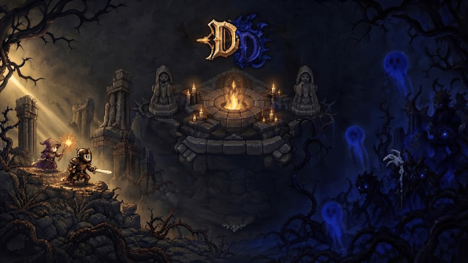

# Dusk and Dawn

**Jouer dans le navigateur / Play in your browser : https://enzo-jct.github.io/dusk-and-dawn/**

## Français

Jeu de survie par vagues en vue isométrique, seul ou à deux, sur le thème ombre et lumière.
Protégez la dernière flamme du temple de l'aube contre les ombres, montez de niveau et choisissez vos bonus.

| | Se déplacer | Valider | Retour / pause |
|---|---|---|---|
| Seul | flèches ou ZQSD | Entrée ou Espace | Échap ou Maj |
| Joueur 1 (à deux) | flèches | Entrée | Échap |
| Joueur 2 (à deux) | ZQSD | Espace | Maj |

L'attaque est automatique. Dans le menu, la touche **L** passe le jeu en anglais.

## English

A wave survival game in isometric view, solo or with a friend, about light and shadow.
Protect the last flame of the Temple of Dawn from the shadows, level up and pick your upgrades.

| | Move | Confirm | Back / pause |
|---|---|---|---|
| Solo | arrows or WASD | Enter or Space | Esc or Shift |
| Player 1 (co-op) | arrows | Enter | Esc |
| Player 2 (co-op) | WASD | Space | Shift |

Attacks are automatic. In the menu, press **L** to switch the game to French.

## Le projet / The project

Jeu réalisé avec Phaser 3 pour la borne d'arcade du BUT MMI de Béziers (SAÉ 301, octobre 2026),
par Alexandre Villiers, Enzo Jacinto et Benjamin Granier. Cette version est adaptée au clavier pour le navigateur.

Made with Phaser 3 for the arcade cabinet of the BUT MMI in Béziers (October 2026),
by Alexandre Villiers, Enzo Jacinto and Benjamin Granier. This version is adapted for keyboard play in the browser.

## Crédits / Credits

- Sol, décor, arbres, trône : Free Undead Tileset Top Down Pixel Art, CraftPix.net
- Chevalier ; dalles, torches, bougies : Free Characters Animations Asset Pack et Rogue Fantasy Catacombs, Szadi art
- Mage : Top Down Pixel Art Wizard, GandalfHardcore
- Ombres et roi de l'ombre : Tiny RPG Character Asset Pack 02, Zerie
- Spectres, crânes, flammes, effets : Dark Spell Effect et Holy Spell Effect, pimen
- Autel et statues : Pixel Art Top Down - Basic, Cainos
- Polices : Cormorant SC et Lora (Google Fonts, SIL Open Font License)
- Musique en jeu : Orchestra 11, Koichi Morita, musique : MaouDamashii (maou.audio)
- Musique du menu : Ring of Black Wings, Zeu ; musique de fin : Requiem, Kaniwa Neon
- Bruitages : Pixabay (universfield, sdanezis, yodguard, oxidvideos)

Les assets restent la propriété de leurs auteurs et ne sont pas redistribuables séparément du jeu.
Assets belong to their authors and may not be redistributed separately from the game.
